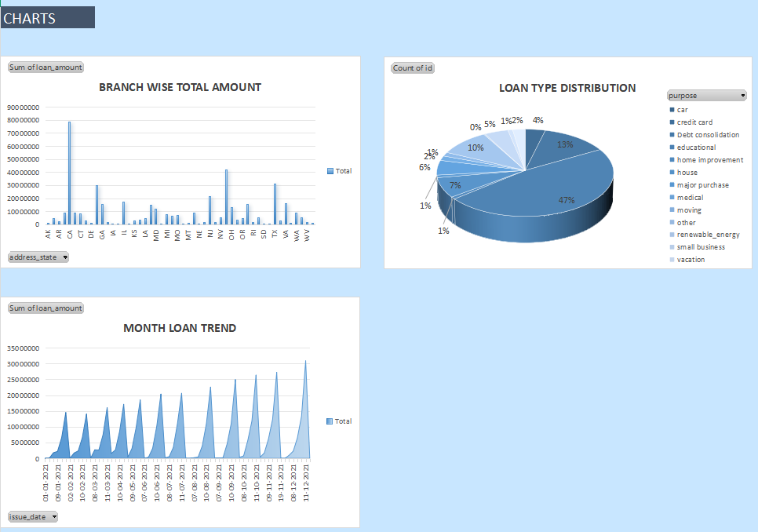
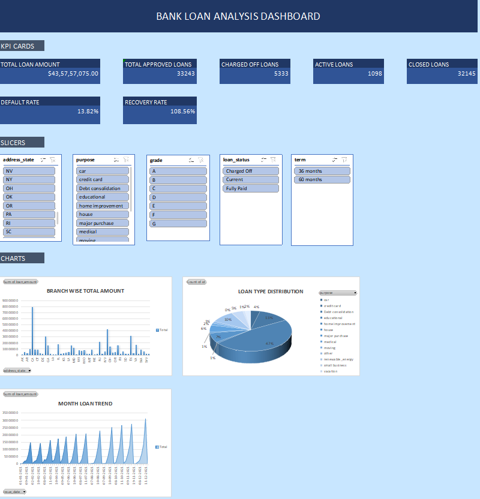

# Banking Loan Performance Analysis

I developed an Excel dashboard analyzing 38,576 loans using Pivot Tables, Slicers, and KPIs, including default rate, recovery rate, branch-wise loan analysis, and monthly trends.

## Dashboard

### 1. Charts

### 2. Complete Dashboard

