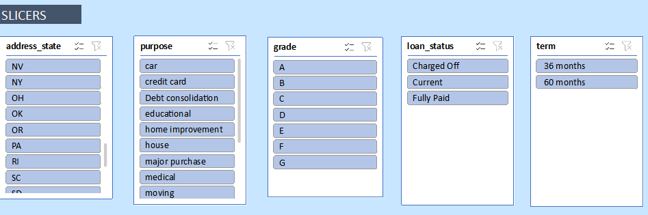

# Banking Loan Performance Analysis

I developed an Excel dashboard analyzing 38,576 loans using Pivot Tables, Slicers, and KPIs, including default rate, recovery rate, branch-wise loan analysis, and monthly trends.

## Dashboard

### 1. KPI Cards

### 2. Slicers

### 3. Charts

### 4. Complete Dashboard

